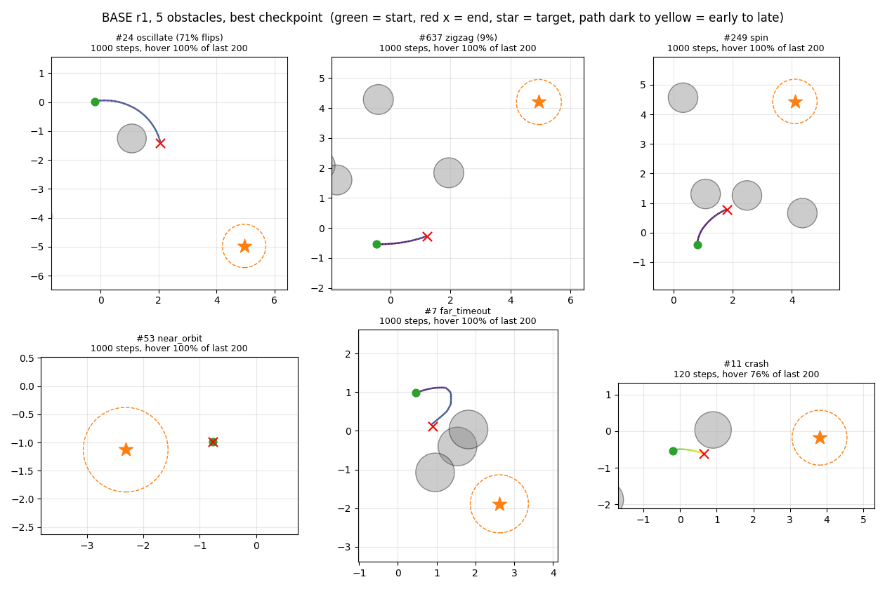
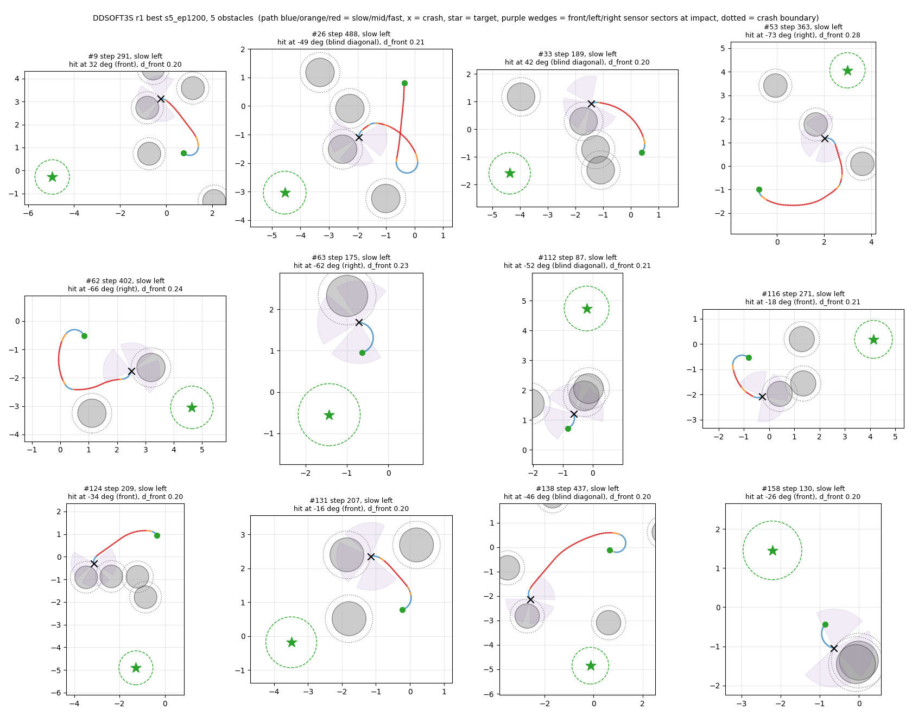
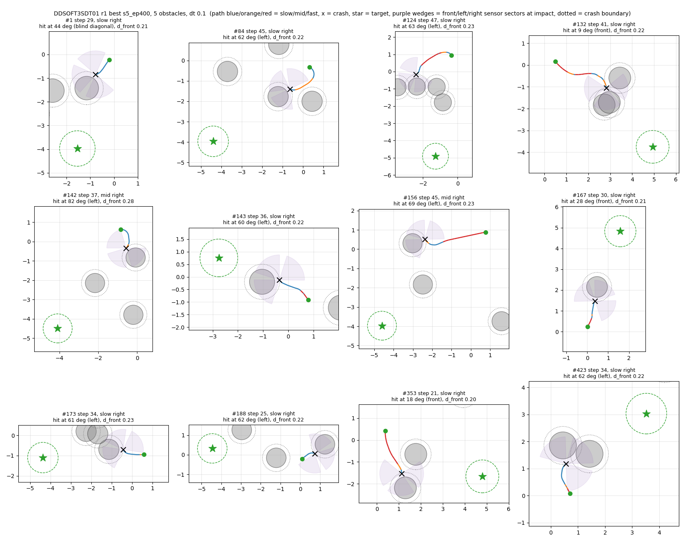

# DQN Drone Obstacle Avoidance, Experiment Summary

Compiled on 2026-10-22. Every number comes from the 2D kinematic environment in `dqn_2d_standalone_oscillation`, and nothing has been tested in Isaac Lab yet.

## Research goals

### Why a 2D environment

- The Isaac Lab simulation includes physics, attitude control and camera rendering, so training is slow, and when something goes wrong it is hard to tell whether the cause is the DQN itself or the simulation layer.
- So I look for a working DQN design in a 2D kinematic environment that uses the same state, actions and control rate as the Isaac env (0.02 s per step). From baseline_v4 the control step is 0.1 s (see "Why a longer control step trains more stably").

### Design constraints

- The input uses only what a real drone can measure, meaning the obstacle distances within the depth-camera sectors and the target's relative position, never the true obstacle coordinates (see "How my environment differs from RipZou's").
- Training happens in simulation, so a curriculum can start from easy scenarios at no real-world cost.

### Main goals

1. Fix oscillation, meaning swinging left and right in front of an obstacle, spinning in place, or hovering stuck.
2. Fix training instability, meaning a policy that learns well midway and then gets worse.
3. Raise the success rate with 5 obstacles, where baseline_v4 reaches 99.44%.

## How my environment differs from RipZou's

RipZou's `dqn_2d_standalone` on `origin/main` feeds the true obstacle coordinates to the network. I consider direct coordinates information a real drone cannot obtain, so my environment still simulates the sensors, only without noise.

| Item | RipZou (`dqn_2d_standalone`) | Mine (`dqn_2d_standalone_oscillation`) |
|---|---|---|
| Obstacle input | Relative center coordinates and radius (ox, oy, r) of the K nearest visible obstacles | Distance to the nearest obstacle surface in each of three 73 degree sectors, front, left and right |
| State | [dx, dy, ox_1, oy_1, r_1, ...], divided by 10 | [d_front, d_left, d_right, dx, dy], with the front sector split into front-left and front-right and the previous action added from baseline_v4 (see "Why baseline_v4 looks the way it does") |
| Field of view | Every direction within 10 m | Only the three camera sectors, with a blind spot behind, matching the three depth cameras of the Isaac env |
| Noise | None | None (`ground_truth` mode), with a separate `camera` mode that emulates camera readings |
| Obstacle shape and layout | Circles of radius 0.5 m, rejection-sampled in a 10 m box, with the first one placed on the straight line from start to target | The same, deliberately reusing RipZou's commit 1643e0e so that both versions use the same obstacle environment |

I also tried `coords` mode, which feeds the coordinates of the nearest obstacle surface points directly, as an upper reference with complete information. With 3 obstacles it reached only 63.98% (3000 ep) and 80.10% (6000 ep), both below the 87.6% of the sensor-distance input. Each length has a single run, so it settles nothing, but it shows no sign that the policy fails without coordinates.

## Evaluation

- A checkpoint is saved every 100 episodes, and the one with the highest success on the validation set (seed 1000, 1,000 layouts) is kept. Ties are broken on seed 2000.
- The reported numbers come from 10,000 layouts of seed 777, which was never used to choose anything.
- **best** is the success rate of the selected checkpoint and stands for what the training can reach.
- **final** is the success rate of the last checkpoint and stands for stability. The larger the gap between the two, the more the policy degraded late in training.
- Success often swings by 30 to 40 percentage points between checkpoints, so every arm runs at least 3 times and comparisons use Welch's t-test.
- One episode in this document is one training block, in which 64 environments each run 100 steps. A real flight lasts at most 20 seconds, which is 1,000 steps at the 0.02 s control step and 200 steps at the 0.1 s step of baseline_v4.

### Failure types

A flight that does not reach the target goes to the first type below that it matches.

| Type | CSV column | Rule |
|---|---|---|
| Crash | `fail crash (%)` | The drone's center comes within 0.2 m of an obstacle surface |
| Out of bounds | `fail out of bounds (%)` | More than 40 m from the target |
| Oscillation | `fail oscillation (%)` | At least 10% of steps turn the opposite way from the previous step (left after right or right after left) |
| Zigzag | `fail zigzag (%)` | At least 5% of steps turn against the previous turn, with straight flight allowed in between |
| Spinning in place | `fail spin in place (%)` | At least 90% of steps are turns |
| Timeout near the target | `fail near-target timeout (%)` | Time runs out within 2 m of the target |
| Far timeout | `fail far timeout (%)` | Time runs out 2 m or more from the target |

The figure below takes the best checkpoint of the first BASE run and, over 3,000 layouts with 5 obstacles, shows the first example of each type. The green dot is the start, the red cross the end and the star the target, and the path runs from dark to light as time goes on.

- Over these 3,000 layouts the failures split into 233 far timeouts, 105 oscillations, 42 crashes, 8 cases of spinning in place, 2 timeouts near the target and 1 zigzag.
- **Apart from the crash, every example spends its last 200 steps stopped.** Oscillation, spinning in place and far timeout differ only in how the drone turns while stopped, swinging left and right, turning one way, or not turning at all. The timeout near the target never even left its start.
- This supports the view that swinging and stopping share one cause. In some states the network rates stopping highest, and once stopped the turns score almost the same, so it stays in place and turns toward whichever side is slightly higher.

## Experiments from the original baseline to baseline_v2

These experiments all came before baseline_v2 was fixed. They start from the original setup on `main` and add one change at a time. Their evaluation differs from later sections, and the opening of each subsection states it. The full per-run numbers are in `docs/results/baseline_to_v2.csv`.

### Two bugs fixed first

| Fix | Before | After | Result (no obstacles, 10 runs per arm) |
|---|---|---|---|
| First transition of a new episode (A1) | Used the last observation of the previous episode | Uses the observation after reset | final median 82.3% to 97.3%, p=0.57 |
| Timeout no longer terminal (V1) | A timeout counted as terminal | Only reaching the target or crashing is terminal | Comparisons start after both fixes |

The same round showed that checkpoint selection has the largest effect of anything tried. Picking best on a separate 1,000 layouts lifted the median of almost every arm to 99% to 100%, while the final checkpoints of one arm ranged from about 20% to 100%, so from then on both best and final are reported.

### Ablation without obstacles

Each arm ran 10 times and was evaluated on 2,000 layouts of seed 1. An arm passed the screen when its final mean beat A1 (81.0%) by at least 5 percentage points without fewer runs at or above 90%.

| Change | final mean | Runs at or above 90% |
|---|---|---|
| R2, progress reward weight 0.05 to 0.15 | 93.2% | 7/10 |
| V9, two output heads (speed times turn) | 93.2% | 7/10 |
| E3, 25% of starts placed 0.8 to 2.0 m from the target | 92.6% | 8/10 |
| E1, learning rate decayed from ep500 to 1/10 | 90.3% | 7/10 |
| V7, Advantage Learning | 89.5% | 8/10 |
| E2, gamma 0.98 to 0.995 | 88.4% | 7/10 |

- No combination replicated. E1 + R2 scored 99.0% and only 92.3% on a rerun. V9 + R2 scored 95.9% and then 87.6%. V9 + V7 reached only 74.3%, so Advantage Learning and the two output heads interfere.
- Changes that hurt were a per-step penalty of -0.01 (R1, only 1/10 runs at or above 90%, p=0.020), oversampling starts with a large heading error (V8, final median 62.8%, p=0.031), and a reversal penalty on top of V2 (V3, oscillation from 2.0% to 5.1%).
- Changes that did not help were a larger reaching bonus (R3), Double DQN (V5), the Huber loss (V6) and a batch of 256 (E5), and V6 and E5 raised oscillation to 15% to 18%.
- Adding hysteresis at evaluation (a left and right reversal must win by delta before the action switches) brought the best checkpoint of all 10 A1 runs to 100%, but it only works at evaluation.
- With 10 runs per arm, no single change or combination beat A1 significantly.

### Ablation with 3 obstacles

Each arm ran 3 times for 1500 ep and was evaluated on 2,000 layouts of seed 1, adding one change at a time to the setup after the bug fixes.

| Change | final | best |
|---|---|---|
| Setup after the bug fixes, 1500 ep | 41.1% (59.2 / 43.8 / 20.4) | 60.0% (70.8 / 58.4 / 50.9) |
| progress reward weight 0.05 to 0.15 | 59.3% (66.3 / 60.6 / 51.0) | 61.8% (73.7 / 60.6 / 51.0) |
| Two output heads | 42.8% (73.7 / 31.0 / 23.7) | 69.8% (85.7 / 72.1 / 51.7) |
| replay buffer 500,000 | 53.1% (67.5 / 65.9 / 25.8) | 56.1% (67.5 / 65.9 / 35.0) |
| replay buffer 500,000, 3000 ep | 65.9% (81.7 / 65.7 / 50.3) | 72.9% (81.7 / 69.8 / 67.2) |
| Two output heads + reward 0.15 + buffer 500,000 | 73.5% (82.5 / 75.8 / 62.3) | 78.2% (86.5 / 75.8 / 72.4) |
| The same, 3000 ep | 74.3% (82.1 / 75.1 / 65.8) | 81.1% (83.6 / 82.1 / 77.5) |
| Plus an exploration floor of 0.03 | 65.5% (77.3 / 77.0 / 42.3) | 87.0% (91.1 / 88.5 / 81.3) |
| The 3000 ep arm with 2 gradient updates per environment step instead, without the 0.03 floor (2 runs) | 41.2% (44.7 / 37.6) | 90.3% (93.7 / 86.9) |
| The 3000 ep arm with the target copied every 20 ep instead, without the 0.03 floor (2 runs) | 80.8% (83.8 / 77.9) | 82.2% (83.8 / 80.5) |

- Changes that did not raise best were learning-rate decay, gamma 0.995, Advantage Learning, a previous-action input, a 256-unit network and a lower learning rate. Learning-rate decay and gamma 0.995 did raise final by about 10 percentage points (see "Getting worse with more training").
- The first 2 runs with the 0.03 floor averaged 89.8%, the third pulled the arm down to 87.0%, and 5 later runs on 10,000 layouts reached only 82.5%, so part of the first gain was luck in selection.

The final setup was then compared with two more changes on 10,000 layouts of seed 777, 3 runs each.

| 3 obstacles | final | best |
|---|---|---|
| The final setup at the time | 60.42% (75.66 / 71.79 / 33.81) | 83.10% (89.40 / 82.85 / 77.04) |
| Plus 2 gradient updates per environment step | 75.61% (85.74 / 71.43 / 69.66) | 86.36% (89.30 / 85.74 / 84.05) |
| Plus the target copied every 20 ep | 73.70% (83.01 / 74.57 / 63.53) | 87.58% (87.93 / 87.71 / 87.09) |

- Both changes mainly reduce late degradation, raising final by 13 to 15 percentage points.
- best rises by 3 to 4.5 percentage points, about the gap between two evaluation sets for one unchanged setup, so only the gain in final is clear.
- Copying the target every 20 ep gave the most consistent 3 runs (87.93%, 87.71%, 87.09%), so it went into baseline_v2.

## Why baseline_v2 looks the way it does

| Change | Before | After | Reason | Evidence (3 obstacles, seed 1, 2,000 layouts, best) |
|---|---|---|---|---|
| First transition of a new episode | The last observation of the previous episode | The observation after reset | A bug that put one wrong transition in every episode | Comparisons start after the fix |
| Timeout no longer terminal | A timeout counted as terminal | Only reaching the target or crashing is terminal | A timeout is not a property of the state, and treating it as terminal teaches wrong Q-values | Comparisons start after the fix |
| Output split into a speed head and a turn head | 3 actions | 2 speeds times 3 turns, 6 actions | The drone can turn while moving forward instead of stopping to turn | 60.0% to 69.8% |
| progress reward weight | 0.05 | 0.15 | The signal was too weak, since the reaching bonus of 100 dwarfs the per-step shaping | final 41.1% to 59.3% |
| replay buffer | 50,000 | 500,000 | With 64 environments running at once, the old buffer held only about the last 780 steps | 72.9% at 3000 ep |
| The three changes above combined (two output heads, progress reward 0.15, buffer 500,000) | | | | 81.1% (3000 ep) |
| Exploration floor | 0.05 | 0.03 | Too many random actions late in training disrupt a learned policy | 87.0% |
| Target copy interval | Every 10 ep | Every 20 ep | A slower-moving target makes the Q-values oscillate less | final 60.4% to 73.7% (seed 777) |
| Training length | 1500 ep | 3000 ep | Runs were often still improving at 1500 ep | See "Ablation with 3 obstacles" |
| Curriculum | Each obstacle count trained from scratch | 1 → 2 → 3 → 5, each stage starting from the previous stage's best | Learn the easy cases before the hard ones | See "New curriculum 1 → 2 → 3 → 5 against the old 3 → 5" |

These settings used to live only in the arguments that outside scripts passed, so leaving out one argument trained a different setup. All of them became code defaults, tagged `baseline_v2.0`.

### Training parameters of baseline_v2

Once the changes above were fixed, these are the defaults of `baseline_v2`.

| Parameter | Value | Note |
|---|---|---|
| `hidden_dim` | 128 | A two-layer MLP with 128 units per layer |
| `learning_rate` | 1e-3 | Adam |
| `gamma` | 0.98 | |
| `batch_size` | 64 | |
| `num_envs` | 64 | Environments run at once |
| `max_steps_per_episode` | 100 | Steps per training block |
| `num_episodes` | 3000 | Per stage, and 1500 for the 1 and 2 obstacle stages of the curriculum |
| `replay_buffer_size` | 500,000 | |
| `epsilon_start`, `epsilon_decay`, `epsilon_min` | 1.0, 0.995, 0.03 | decay is applied once per training block |
| `resume_epsilon` | 0.3 | epsilon when a stage resumes from the previous stage |
| `target_update_every` | 20 | The online network is copied to the target every 20 training blocks |
| `forward_speed`, `turn_rate` | 1.5 m/s, 0.8 rad/s | |
| progress reward weight `K_PROGRESS` | 0.15 | Each step earns 0.15 times forward speed times the cosine of the heading error |
| Reaching bonus, crash penalty | 100, -50 | |
| curriculum `--stages` | 1, 2, 3 and then 5 obstacles | Each stage starts from the previous stage's best weights, weights only |

Every later experiment changes only the following on top of these defaults.

| Experiment | Change |
|---|---|
| SOFT | New `target_tau` of 0.0005, a soft update after every gradient step that replaces the full target copy |
| DDQN | How the TD target is computed, with no new parameter |
| Time penalty | The environment adds a reward of -0.05 at every step |
| V2, V2S | The state gains a one-hot of the previous action (3 or 4 values) |
| No hover | Both speeds fly forward |
| Three forward speeds | The actions become 0.3, 0.75 or 1.5 m/s times 3 turns, with `num_actions` 9 |

## Experiments from baseline_v2 to baseline_v3

The full per-run numbers for every stage are in `docs/results/v2_to_v3.csv`.

### Results of single changes

The numbers are means (%) on 10,000 layouts of seed 777 with 5 obstacles unless stated otherwise.

| Experiment | Runs | best | final | Oscillation | Far timeout | Crash |
|---|---|---|---|---|---|---|
| BASE (baseline_v2) | 5 | 89.45 (92.21 / 91.83 / 90.68 / 86.77 / 85.78) | 64.15 (79.59 / 79.07 / 70.03 / 47.00 / 45.04) | 3.78 | 3.75 | 2.20 |
| Soft target update (SOFT) | 5 | **93.17** (94.39 / 94.33 / 92.80 / 92.39 / 91.96) | 68.18 (91.96 / 73.68 / 70.17 / 66.21 / 38.86) | **2.07** | 1.47 | 1.83 |
| Double DQN (DDQN) | 3 | 91.82 (93.21 / 92.25 / 90.01) | 62.55 (85.96 / 70.93 / 30.75) | 3.22 | 2.30 | 1.26 |
| Time penalty + DDQN | 3 | 90.64 (93.92 / 91.25 / 86.75) | 74.91 (87.00 / 74.71 / 63.01) | 5.00 | 3.07 | 0.88 |
| Per-step time penalty 0.05 (TP) | 3 | 88.41 (89.51 / 88.64 / 87.07) | 73.16 (73.50 / 73.08 / 72.91) | 6.54 | 1.35 | 2.79 |
| Previous turn and speed (V2S) | 3 | 86.54 (91.24 / 84.34 / 84.03) | 61.96 (86.30 / 67.03 / 32.56) | 7.45 | 3.80 | 0.65 |
| Previous turn (V2) | 3 | 86.11 (88.57 / 85.49 / 84.26) | 64.06 (72.64 / 60.06 / 59.47) | | | |
| No hover | 3 | 71.06 (73.20 / 71.51 / 68.47) | 62.46 (65.82 / 63.77 / 57.80) | 0.01 | 0.00 | 27.65 |

### Expectations, results and likely causes

**SOFT (the target moves 0.05% toward the online network at every step)**
- The expectation was that a target no longer jumping every 20 ep gives a smoother learning target and steadier training.
- best rose by 3.7 percentage points, p=0.046, the only significant improvement so far, with all 5 runs at or above 91.96%. Oscillation also roughly halved. final did not improve (68.18%, p=0.73), and the fifth run ended at only 38.86%.
- A likely cause is that a smooth target makes the Q-values more accurate, so better checkpoints can be found. Late collapse has causes beyond the jumping target, so final did not follow.

**DDQN**
- The expectation was less overestimation of Q-values.
- best rose by 2.4 percentage points, but p=0.20. With 3 obstacles oscillation fell from 4.94% to 2.05%. final did not improve.
- A likely cause is that overestimation is real but not the main source of late degradation.

**Time penalty (-0.05 per step)**
- The expectation was that stopping or spinning in place would no longer score 0, so hovering stuck would drop.
- Far timeouts fell from 5.90% (the first 3 BASE runs) to 1.35% and final rose by about 9 percentage points, but best did not rise, and oscillation and crashes increased.
- A likely cause is that the penalty forces the drone to keep moving, so it gets stuck less, but it pushes through or turns erratically in front of obstacles more often.
- This is not necessarily bad. The penalty keeps the network from settling in place and makes it keep trying to move forward, and the extra crashes may come partly from the three range readings missing obstacles, for example in the rear quarters. If the input later becomes camera images with more information, a policy that does not stop has a better chance of learning to avoid them. This is an untested hypothesis. Three forward speeds reach a similar effect by making a full stop impossible, with better results (see "Combinations"). The later crash analysis found other causes, a slowest speed whose turn radius is too large and an input that cannot tell left from right, while only about 17% to 26% of crashes hit an obstacle in the blind diagonals between the front and side sectors (see "The action-space limit" and "The observation limit").

**Previous action as input (V2, V2S)**
- The expectation was that knowing the previous action would let the network avoid swinging left and right.
- Both made things worse, and V2S doubled oscillation. Adding it to DDQN made things worse as well (see "Combinations").
- There are four likely causes. First, copying the previous action is right most of the time, so the network easily learns that shortcut and then fails to switch when it should, which imitation learning calls the copycat problem or causal confusion. Second, the action shapes the next input and the next input shapes the action, which can form a self-reinforcing loop. Third, the next state in the TD target contains the action just taken, which makes the learning target less stable. Fourth, the input size differs, so these runs cannot start from the shared obstacle-free checkpoint (although the experiment in "New curriculum 1 → 2 → 3 → 5 against the old 3 → 5" shows the starting point has no significant effect).

**No hover (every action flies forward)**
- The expectation was to remove hovering stuck and spinning in place at the root.
- With 3 obstacles crashes rose to 14% to 17% and best fell to 78.66%. With 5 obstacles crashes reached 27.65% and best 71.06%.
- A likely cause is that the drone needs to slow down or stop to reorient in front of an obstacle. This is why the design later moved to three forward speeds (see "Combinations").

### New curriculum 1 → 2 → 3 → 5 against the old 3 → 5

- I first expected the old curriculum to be better, because the first few arms seemed to score higher with it.
- To rule out the effect of the starting point, I used different obstacle-free starting checkpoints (A, B, C) and ran 5 times per cell.

best (%) with 5 obstacles, sorted from high to low in each cell.

| Start | New curriculum 1 → 2 → 3 → 5 | Old curriculum 3 → 5 |
|---|---|---|
| A | 92.21 / 91.83 / 90.68 / 86.77 / 85.78 | 91.98 / 90.81 / 89.02 / 88.49 / 86.17 |
| B | 94.08 / 91.42 / 88.36 / 84.26 / 82.40 | 94.23 / 92.33 / 91.79 / 89.13 / 84.70 |
| C | 89.40 / 88.62 / 87.72 / 84.33 / 83.36 | 89.80 / 89.45 / 88.63 / 81.08 / 77.27 |

- The two curricula do not differ. Pooled over the three starts, the new one scores 88.08% and the old one 88.33%, p=0.87. In a two-way ANOVA the curriculum gives p=0.87, the start p=0.11 and their interaction p=0.55.
- The gap seen earlier came from the first 3 BASE runs happening to score low, and it vanished once there were 5.
- With 3 obstacles the new curriculum was actually better for start C (92.10% against 85.98%, p=0.044), but that is 1 of 6 comparisons and it is not significant after correcting for multiple comparisons.
- The decision is to keep 1 → 2 → 3 → 5. The two reach the same success rate, while the new one is more intuitive and varies less with 3 obstacles.

### Combinations

Each combination is compared only with the arm that has one change fewer.
- baseline_v2 against DDQN, see "Results of single changes".
- DDQN against DDQN + SOFT.
- DDQN against DDQN + previous turn and speed.
- DDQN against DDQN + three forward speeds.
- DDQN + previous turn and speed against the same with three forward speeds added.

| Experiment (5 obstacles) | Runs | best | final | Oscillation | Far timeout | Crash |
|---|---|---|---|---|---|---|
| baseline_v2 | 5 | 89.45 (92.21 / 91.83 / 90.68 / 86.77 / 85.78) | 64.15 (79.59 / 79.07 / 70.03 / 47.00 / 45.04) | 3.78 | 3.75 | 2.20 |
| DDQN | 3 | 91.82 (93.21 / 92.25 / 90.01) | 62.55 (85.96 / 70.93 / 30.75) | 3.22 | 2.30 | 1.26 |
| **DDQN + SOFT** | 3 | 91.80 (93.90 / 91.07 / 90.43) | **83.12** (91.07 / 87.96 / 70.32) | 3.67 | 1.51 | 1.29 |
| DDQN + previous turn and speed | 3 | 84.98 (85.40 / 85.08 / 84.46) | 66.11 (76.17 / 63.84 / 58.31) | 4.56 | 8.54 | 0.29 |
| DDQN + three forward speeds | 3 | 92.26 (93.66 / 92.43 / 90.68) | 67.17 (86.03 / 62.87 / 52.61) | 0.02 | 0.08 | 7.63 |
| DDQN + previous turn and speed + three forward speeds | 3 | 91.56 (92.39 / 91.32 / 90.96) | 77.76 (86.48 / 84.72 / 62.09) | 0.29 | 0.00 | 7.80 |

**DDQN + SOFT**
- The expectation was that the two changes address different problems, so their effects could add up.
- best did not rise (91.80% against 91.82%), but final rose from 62.55% to 83.12%, with runs of 70.32%, 87.96% and 91.07%. It is the most stable combination late in training among these. Against baseline_v2 p=0.11, which is not yet significant with 3 runs.
- A likely cause is that DDQN reduces overestimation and SOFT smooths the target, and together they keep the Q-values from drifting late in training, so the policy degrades less. best did not rise further, which suggests the ceiling is set by something else, such as the action design or the state information.

**DDQN + previous turn and speed**
- The expectation was that once DDQN makes the Q-values more accurate, the previous-action input might stop doing harm.
- best fell from 91.82% to 84.98% and far timeouts rose from 2.30% to 8.54%, as bad as on baseline_v2.
- A likely cause is that none of the four causes listed in "Expectations, results and likely causes" has to do with Q-value overestimation, so DDQN cannot reach them.

**Three forward speeds (0.3, 0.75 or 1.5 m/s, times 3 turns)**
- The motivation is that removing hover leads to crashes, while hover is the source of hovering stuck, so the drone may slow down but can never fully stop.
- The speeds were chosen with the turning radius in mind. At a turn rate of 0.8 rad/s the radii are 0.38, 0.94 and 1.88 m, all inside the ±5 m arena. Fitting inside the arena turned out not to be enough. The later crash analysis showed that 0.375 m is too wide to steer off an obstacle that is already close, which led to lowering the speeds (see "The action-space limit").
- With three speeds added to DDQN, best is 92.26%, on par with DDQN's 91.82%, while oscillation falls from 3.22% to 0.02% and far timeouts from 2.30% to 0.08%. Stopping and swinging almost disappear, and nearly every failure becomes a crash (7.63%).
- final did not improve (67.17% against 62.55%, p=0.82), so three speeds fix swinging and stopping, not training instability.
- Adding three speeds to the arm with the previous-action input lifted best from 84.98% to 91.56%, back to the level of DDQN. Three speeds also remove the stopping that the previous-action input caused.

## Why baseline_v3 looks the way it does

`baseline_v3` is `baseline_v2` plus Double DQN and a soft target update, tagged `baseline_v3.0`. Every new experiment branches from it, and its control is DDQN + SOFT.

| Change | Before | After | Reason |
|---|---|---|---|
| Double DQN | The target network both selects and evaluates the action | The online network selects the action and the target network evaluates it | Taking the max in plain DQN picks overestimated actions, and separating selection from evaluation reduces overestimation |
| Soft target update | The online network is copied to the target every 20 ep | The target moves 0.05% toward the online network at every gradient step | The learning target no longer jumps at fixed intervals, so the Q-values swing less |

Evidence (5 obstacles, seed 777, 10,000 layouts)
- Double DQN alone raised best from 89.45% to 91.82%, p=0.20. final did not improve.
- With the soft target update added, best held at 91.80% and final rose from 62.55% to 83.12%. With 2 and 3 obstacles final also rose by 11 and 16 percentage points, in the same direction.
- Each arm has only 3 runs, and against DDQN the final at 5 obstacles gives p=0.34. It was chosen because the three stages point the same way and because it best serves the goal of training that converges.
- SOFT alone has a higher best (93.17%), but its final is only 68.18%, so it was not chosen.

Double DQN was tried once before baseline_v2 (V5, see "Ablation without obstacles"), when it did not help and scored below A1.

| No obstacles, 10 runs per arm | final median | final mean | final at or above 90% | best median | best at or above 90% |
|---|---|---|---|---|---|
| A1 (control) | 97.3% | 81.0% | 7/10 | 99.8% | 9/10 |
| V5 (Double DQN) | 85.0% | 73.4% | 4/10 | 96.1% | 6/10 |

- The difference is not significant, with p=0.43 for final and p=0.13 for best. It was mostly pulled down by a few very poor runs, such as one whose final was only 6.9%, with 77.9% of its episodes spinning in place.
- The conditions then differed from later ones. There were no obstacles, 3 actions, a buffer of 50,000, a target copied every 10 ep and a progress reward of 0.05.
- Without obstacles the best of A1 was already close to 100%, which left DDQN almost no room to improve. Reducing Q-value overestimation matters more in hard scenarios, which is why the gains in best and oscillation appeared only with obstacles on the new setup.

## Experiments from baseline_v3 to baseline_v4

These experiments are all built on baseline_v3, so each is compared with DDQN + SOFT. DDQN + SOFT was later extended to 5 runs, and this section uses those 5 runs, 92.20% best and 81.28% final. The full per-run numbers for every stage are in `docs/results/after_v3.csv`.

Every number is 5 obstacles, seed 777, 10,000 layouts, with each run in parentheses from highest to lowest. p-values are Welch t-tests against DDQN + SOFT.

### Single changes

| Experiment | Runs | best | final | Oscillation | Crash |
|---|---|---|---|---|---|
| DDQN + SOFT (baseline_v3) | 5 | 92.20 (94.34 / 93.90 / 91.25 / 91.07 / 90.43) | 81.28 (91.07 / 87.96 / 86.60 / 70.43 / 70.32) | 2.97 | 1.70 |
| Three forward speeds 0.3 / 0.75 / 1.5 m/s | 3 | 91.76 (94.38 / 92.04 / 88.86) | 87.60 (92.13 / 85.65 / 85.03) | 0.01 | 8.21 |
| Three forward speeds, crash penalty -50 to -100 | 3 | 91.00 (93.82 / 91.91 / 87.28) | 75.01 (88.59 / 80.37 / 56.07) | 0.00 | 8.98 |
| replay buffer 500,000 to 2,000,000 | 3 | 90.13 (92.90 / 88.80 / 88.70) | 73.71 (83.25 / 72.31 / 65.57) | 2.81 | 2.91 |
| gamma 0.98 to 0.996 | 3 | 81.87 (86.32 / 83.02 / 76.28) | 63.54 (69.42 / 64.80 / 56.40), p=0.025 | 14.03 | 0.80 |
| **Control step dt 0.02 s to 0.1 s** | 5 | **94.63** (95.15 / 95.10 / 94.76 / 94.64 / 93.49), p=0.035 | **92.59** (95.99 / 92.49 / 92.29 / 92.13 / 90.05), p=0.065 | 4.90 | 0.17 |
| Own obstacle-free stage, dt unchanged | 3 | 90.39 (91.92 / 91.74 / 87.52) | 71.67 (80.71 / 69.61 / 64.69) | 2.39 | 2.12 |

**Three forward speeds**
- The actions become 3 forward speeds times 3 turns, 9 in all, with no stop. The expectation was that moving slowly could replace stopping.
- Oscillation and far timeouts almost vanished, and final was the highest at the time at 87.60%, but best did not move, and nearly every failure became a crash (8.21%).

**Crash penalty doubled**
- The expectation was that the network would become more careful and crash less.
- Crashes did not drop (8.21% to 8.98%), the three runs of each overlap almost completely, and final fell from 87.60% to 75.01%.
- The analysis in "The action-space limit" shows these crashes were mostly impossible to avoid physically. A penalty only makes the network more afraid of crashing without giving it a new way to avoid one, and a larger value widens the range of the TD target.

**replay buffer enlarged to 2,000,000**
- The expectation was that hard states would stay in the buffer longer and late forgetting would shrink.
- final fell from 83.12% to 73.71% (against the 3-run DDQN + SOFT of the time), so the hypothesis that a short buffer causes forgetting is not supported. A likely cause is that a very large buffer holds a larger share of data from outdated policies.

**Control step dt 0.1 s**
- Someone else reported that changing dt from 0.02 to 0.1 made results much more stable. dt is the interval between decisions. Every dt seconds the network looks at the state and picks an action, so a 20 s flight goes from 1,000 steps to 200.
- best and final both rose, all 5 final values are above 90%, and the training instability is largely solved.
- The reason is in "Why a longer control step trains more stably".

**gamma 0.996**
- gamma discounts once per step, so dt 0.1 stretches the horizon from about 1 s to about 5 s. This arm raised gamma to 0.996 at dt 0.02 to give the same horizon, to tell whether the effect of dt 0.1 comes from the longer horizon alone.
- It got clearly worse, with oscillation at 14.03%. So the effect of dt 0.1 does not come from the horizon.

**Own obstacle-free stage**
- dt 0.1 cannot reuse the shared starting checkpoint trained at dt 0.02, so it trains its own stage with no obstacles. This arm also trains its own obstacle-free stage at dt 0.02, to rule out the different start.
- It is worse than DDQN + SOFT, so the gain of dt 0.1 does not come from training its own first stage, and against this arm with the same start the effect of dt 0.1 is even larger.

### Speed values of the three forward speeds and the control step

| Experiment | Speeds (m/s) | dt (s) | best | final | Oscillation | Crash |
|---|---|---|---|---|---|---|
| Three forward speeds | 0.3 / 0.75 / 1.5 | 0.02 | 91.76 (94.38 / 92.04 / 88.86) | 87.60 (92.13 / 85.65 / 85.03) | 0.01 | 8.21 |
| Slowest speed lowered | 0.15 / 0.45 / 1.5 | 0.02 | 94.42 (96.18 / 94.21 / 92.88) | 79.06 (94.23 / 89.18 / 53.77) | 0.08 | 5.37 |
| Slowest speed lowered further | 0.075 / 0.3 / 1.5 | 0.02 | 94.44 (95.02 / 94.35 / 93.95) | 86.66 (90.41 / 86.97 / 82.60) | 0.36 | 4.44 |
| Three forward speeds, gamma 0.996 | 0.3 / 0.75 / 1.5 | 0.02 | 90.38 (91.32 / 91.30 / 88.52) | 75.28 (86.07 / 81.65 / 58.11) | 0.09 | 9.41 |
| Three forward speeds | 0.3 / 0.75 / 1.5 | 0.1 | 95.17 (95.71 / 95.08 / 94.71) | 94.19 (94.65 / 94.44 / 93.48) | 0.11 | 4.68 |
| Q network with one output per action | 0.3 / 0.75 / 1.5 | 0.1 | 96.14 (97.42 / 95.61 / 95.40) | 95.89 (97.25 / 95.27 / 95.16) | 0.11 | 3.69 |
| **C, slowest speed lowered plus dt 0.1** | 0.075 / 0.3 / 1.5 | 0.1 | **98.94** (99.25 / 98.90 / 98.68) | **97.93** (98.72 / 97.81 / 97.26) | 0.37 | 0.65 |

- Lowering the slowest speed follows from the analysis in "The action-space limit". At dt 0.02 best rises by about 2.7 percentage points, but at p=0.23 against the original speeds and with no better final, so on its own it cannot be called better.
- At dt 0.1, 0.075 / 0.3 / 1.5 m/s is far better than 0.3 / 0.75 / 1.5 m/s, at p=0.001 for best and p=0.003 for final, and the three runs do not overlap. The two changes together do far more than either alone.
- This arm became the interim baseline, called C.
- A Q network with one output per action helped, but much less. Its outputs grow with every combination of speeds and turns, so it will not be tried again.

### The 2x2 on candidate C

With C as the interim baseline, this compares 3 sectors and 4 sectors (see "The observation limit"), with and without the previous-action input (V2S).

| | Without V2S | With V2S |
|---|---|---|
| 3 sectors | 98.94 (99.25 / 98.90 / 98.68) / 97.93 (98.72 / 97.81 / 97.26), crash 0.65 | 99.31 (99.59 / 99.30 / 99.05) / 98.43 (98.97 / 98.82 / 97.50), crash 0.61 |
| 4 sectors | **99.50** (99.65 / 99.44 / 99.40) / **98.96** (99.50 / 98.72 / 98.65), crash 0.43 | 99.44 (99.52 / 99.44 / 99.35) / 98.91 (99.18 / 98.92 / 98.63), crash 0.50 |

Each cell gives best, then final.

| Comparison | p for best | p for final |
|---|---|---|
| 4 against 3 sectors, without V2S | 0.061 | 0.12 |
| 4 against 3 sectors, with V2S | 0.52 | 0.42 |
| With against without V2S, 3 sectors | 0.18 | 0.47 |
| With against without V2S, 4 sectors | 0.56 | 0.89 |

- All four cells are near 99%, and three runs cannot separate them statistically.
- 4 sectors without V2S has the highest mean and the fewest crashes.
- V2S helps a little with 3 sectors and not at all with 4. What V2S can add is breaking the left-right dithering, and 4 sectors already removes it.
- With 4 sectors alone at the old speeds 0.3 / 0.75 / 1.5 m/s, best also rose from 95.17% to 99.26% (99.35 / 99.28 / 99.15), with 0.00% oscillation.

## Limits built into the design

Both problems in this section come from the action space and the input themselves. They have nothing to do with how well the network trains or how its parameters are set, and no amount of learning gets around them.
- The action-space limit is about what the drone cannot do. Once it is too close to an obstacle, no control avoids it.
- The observation limit is about what the drone cannot know. The input lacks the information it needs, so even the best policy can only guess, and a wrong guess crashes.

### The action-space limit, a minimum turn radius that is too large

With three forward speeds 0.3 / 0.75 / 1.5 m/s at dt 0.02, nearly every failure was a crash. The best checkpoint of the first training run was replayed on 2,000 layouts. Of its 121 crashes (6.05%), the last action was the slow speed in 97% and a left turn in 98%, and d_front on the step before impact had a median of 0.20 m.

- At 0.3 m/s and a turn rate of 0.8 rad/s, the smallest turn radius is 0.375 m.
- The last unbroken run of slow left turns before impact lasted a median of 52 steps and began with a median surface gap of 0.46 m. The network did start turning early, it just could not turn tightly enough.
- Holding a different action for a full circle from where that run began avoided every obstacle in the following share of crashes.

| Held from the same position | Turn radius | Avoids every obstacle |
|---|---|---|
| Left at 0.3 m/s, the action taken | 0.375 m | 1% |
| Left at 0.15 m/s | 0.19 m | 76% |
| Left at 0.075 m/s | 0.09 m | 95% |
| Right at 0.3 m/s | 0.375 m | 46% |

- So the slowest speed is too fast. Crashes that cannot turn away come from a physical limit, not from a network that is not afraid enough of crashing, which also explains why doubling the crash penalty failed.
- Lowering the speeds to 0.075 / 0.3 / 1.5 m/s brings the turn radius down to about 0.09 m. At dt 0.1, crashes fell from 4.68% to 0.65% and best rose from 95.17% to 98.94% (the C in "Speed values of the three forward speeds and the control step").

### The observation limit, three sectors cannot tell left from right

After dt 0.1, crashes looked different. In the arm with three speeds and dt 0.1 (95.17%), 91% of crashes happened during a right turn and the obstacle hit was on the left in 84%.

Replaying one of these crashes step by step showed the following.
- At the start it is 1.03 m from the obstacle surface, enough room to turn away.
- For the next 16 steps the network alternates left and right every step at the slow speed, while d_front shrinks from 0.88 m to 0.43 m. Meanwhile the right reading jumps between about 3.3 m and 10 m, because the heading moves only 4.6 degrees a step and another obstacle crosses the edge of the sector each time.
- By the time it commits to turning right it is too close, and its left side grazes the obstacle.

Across three training runs, 44%, 52% and 17% of crashes followed 4 or more left-right reversals in the last 2 s, and in 64% to 78% of those the surface gap at the first reversal was about 0.7 m, enough to turn away. At dt 0.02 only 21% of crashes were of this kind, with a gap of only 0.45 m at the first reversal.

The cause is the input design.
- The state is [d_front, d_left, d_right, dx, dy], and d_front is only the distance to the nearest obstacle within 36.5 degrees of the heading. An obstacle 10 degrees left or 10 degrees right of the heading gives the same d_front.
- So when an obstacle sits right on the line between the drone and the target, turning left and turning right give almost the same state and almost the same Q-values. Any small change, such as a jump in a side reading, flips the choice, and the drone dithers on that line.
- The right rule is to turn left when the obstacle is right of the heading and right when it is left of it. The network never receives which side the obstacle is on, so it cannot learn that rule.

The fix splits the front sector into a front-left half (0 to +36.5 degrees) and a front-right half (0 to -36.5 degrees). Coverage stays the same and the state grows from 5 to 6 values. A depth camera already sees which side of the image an obstacle is on, so this is still information a real drone has.
- This change alone raised best from 95.17% to 99.26%, with oscillation at 0.00%.
- On C it reaches 99.50% (see "The 2x2 on candidate C").

## Why a longer control step trains more stably

A shorter control interval usually means faster reactions, but here the network must learn the value of each action by Q-learning, and too short an interval makes that harder.
- At dt 0.02 an action lasts only 0.02 s, so even at 1.5 m/s the drone moves 3 cm, and turning left, turning right or going straight lead to almost the same outcome. The Q-value gap between actions scales roughly with dt, while the network's error in estimating Q-values does not shrink with it. Once the gap is smaller than the error, the argmax keeps flipping, which shows up as left-right swinging and as final falling. Tallec, Blier and Ollivier proved in *Making Deep Q-learning Methods Robust to Time Discretization* (ICML 2019) that Q-learning breaks down as dt goes to 0.
- The +100 for reaching the target has to propagate back one TD update at a time, over 1,000 steps at dt 0.02 but only 200 at dt 0.1.
- Only stretching the horizon made things worse (gamma 0.996 in "Single changes"), which fits the first point. With dt unchanged the Q-value gap stays just as small, and a longer horizon only makes the Q-values and their error larger together.
- The cost is slower reactions, since a full-speed step covers 0.15 m. On a real drone the network can decide every 0.1 s (10 Hz) while the low-level flight controller still runs at 50 Hz, the same idea as the Atari DQN repeating each action for 4 frames.

## Why baseline_v4 looks the way it does

`baseline_v4` was built from `baseline_v3` by merging in the 4-sector, previous-action cell of "The 2x2 on candidate C", plus two fixes that do not change results.

| Change | Before | After | Reason and evidence |
|---|---|---|---|
| Forward speeds | stop or 1.5 m/s | 0.075 / 0.3 / 1.5 m/s, no stop | Removes stopping and swinging ("Single changes"), and the smallest turn radius falls from 0.375 m to about 0.09 m ("The action-space limit") |
| Control step | 0.02 s | 0.1 s | best and final both rise, all 5 final values above 90% ("Single changes", "Why a longer control step trains more stably") |
| Front sector | 1 | front-left and front-right | Tells the network which side the obstacle is on, and oscillation falls to 0 ("The observation limit") |
| Previous action (V2S) | none | one-hots of the previous turn and speed | See the discussion below |
| Memory of the tie-break | curriculum.py held torch for the whole chain, about 1.3 GB | scored in a child process, about 11 MB | On two past tie-breaks the old and new code wrote identical records and checkpoints |
| Parameters of the action mapping | `--forward_speed` and three others had no effect or mapped wrongly | the mapping uses the run's own config | Default values give the same raw actions as before, and no past experiment changed these parameters |

On the 2x2 on C this setup reached 99.44% best and 98.91% final, against 92.20% and 81.28% for baseline_v3.

**Whether to add V2S**

This was my decision, and it differs from Claude's recommendation, so both sides' reasons are recorded here.

My reasons
- Adding V2S should be a safeguard. If the previous action is truly useless to the model, its weights should become small during training and do no harm.
- It did not hurt with 4 sectors (99.44% against 99.50%, p=0.56).

Claude's counterargument
- Useless inputs are not pushed to 0 on their own. Training has no weight decay or L2 penalty, so nothing drives a weight toward 0. DQN targets are noisy, and an input that happens to correlate with that noise gets used.
- Measurement agrees. In the three trained networks with 4 sectors and V2S, the norm of each first-layer weight column for a previous-action input grew from about 1.9 at initialization to 4.6 to 6.7, so the network does use these inputs.
- The previous action is highly correlated with the current one, so the network easily learns the shortcut of repeating what it just did, and the state changes with the network's own decisions, which makes the training distribution less stable.
- In this project V2S has caused harm before. Adding it to DDQN dropped best from 91.82% to 84.98%, and at best it made no difference.
- The left-right dithering it would address is already solved by 4 sectors. Its cost is a state of 12 values instead of 6.
- Where it may really be needed is an environment with inertia and delay, such as Isaac Lab or a real drone. In this 2D kinematic model every step switches straight to the new command, so the previous action carries no extra information.

The final decision was to include V2S, and to test weight decay separately to see whether it really pushes useless weights down.

## Evidence on the two core problems

This section also includes the ablations from before baseline_v2. The numbers come from five sources.
- "Stage 0" means no obstacles, 10 runs per arm.
- "3 obstacles, old" means 3 obstacles, seed 1, 2,000 layouts, 1500 ep, 3 runs per arm.
- "3 obstacles, old, 3000 ep" is the same evaluation with 3000 ep of training.
- "3 obstacles, seed 777" means 3 obstacles, seed 777, 10,000 layouts.
- "5 obstacles" is the main evaluation of this document, seed 777 with 10,000 layouts.

### Swinging and stopping

The trajectories in "Failure types" show that every failure other than a crash ends with the drone stopped, so the two problems can be treated together.

| Attempt | Setting | Effect on swinging and stopping |
|---|---|---|
| Hysteresis at evaluation (a left and right reversal must win by delta before the action switches) | 3 obstacles, old | best rises by 1 to 8 percentage points, only at evaluation, and stopping near the target is not fixed |
| Two output heads (V9) | 3 obstacles, old | Oscillation falls from 22.7% to 9.6%, but far timeouts rise from 1.5% to 15.2%, so swinging turns into stopping |
| progress reward 0.15 (R2) | 3 obstacles, old | Alone it raises oscillation from 22.7% to 37.9%, and it helps only together with V9 |
| Per-step penalty -0.01 (R1) | Stage 0 | Worse, with stopping near the target rising to 15.5% |
| Reversal penalty (V3, on top of V2) | Stage 0 | Oscillation rises from 2.0% to 5.1% |
| Advantage Learning (V7) | 3 obstacles, old | best only 34.8%, with 25.4% spinning in place |
| Oversampling large heading errors at the start (V8) | Stage 0 | final median falls to 62.8%, p=0.031 |
| Batch 256, Huber loss | Stage 0 | Oscillation rises to 15% to 18% |
| Previous-action input (V2, V2S) | 5 obstacles | Both worse, V2S oscillation 7.45% |
| Per-step time penalty -0.05 | 5 obstacles | Stopping falls from 5.90% to 1.35%, while oscillation and crashes rise |
| No hover | 3 and 5 obstacles | Stopping disappears, but crashes reach 14% to 17% with 3 obstacles and 27.65% with 5 |
| DDQN | 5 obstacles | Oscillation 3.78% to 3.22%, and with 3 obstacles 4.94% to 2.05% |
| SOFT | 5 obstacles | Oscillation 3.78% to 2.07%, far timeouts 3.75% to 1.47% |
| DDQN + three forward speeds | 5 obstacles | Oscillation 3.22% to 0.02%, far timeouts 2.30% to 0.08%, crashes 1.26% to 7.63% |
| DDQN + SOFT + three forward speeds | 5 obstacles | Oscillation 0.01%, far timeouts 0%, crashes 8.21% |
| Crash penalty doubled on top | 5 obstacles | Crashes do not drop (8.98%) |
| Three forward speeds plus dt 0.1 | 5 obstacles | Oscillation 0.11%, crashes 4.68%, but about 40% of crashes come from dithering on the line ("The observation limit") |
| **Slowest speed lowered to 0.075 m/s, plus dt 0.1 (C)** | 5 obstacles | Crashes fall to 0.65%, oscillation 0.37% |
| **Front sector split in two** | 5 obstacles | Oscillation 0.00%, crashes 0.74% |
| **C plus 4 sectors** | 5 obstacles | Oscillation 0.07%, crashes 0.43% |

My current understanding has three parts.
- A step spent stopped earns a progress reward of 0, while moving toward an obstacle risks a crash. So in front of an obstacle stopping is often the action with the highest Q-value, and once stopped the left and right turns score almost the same, so the drone swings in place.
- Once stopping is removed, swinging and crashing have two separate causes. One is a slowest speed whose turn radius is too large to turn away ("The action-space limit"). The other is an input that cannot tell whether an obstacle is on the left or the right, so the drone hesitates on the line ("The observation limit").
- Lowering the slowest speed and splitting the front sector each bring success to about 99%, and they handle different kinds of failure.

### Getting worse with more training (final far below best)

| Attempt | Setting | Change in final |
|---|---|---|
| Fixing the first transition of an episode (A1) | Stage 0 | median 82.3% to 97.3%, p=0.57 |
| replay buffer 50,000 to 500,000 | 3 obstacles, old | 41.1% to 53.1% |
| Learning rate decayed from ep500 to 1/10 (E1) | 3 obstacles, old | 41.1% to 52.2%, and 99.0% at Stage 0 when combined with R2, but only 92.3% on a rerun |
| gamma 0.995 (E2) | 3 obstacles, old | 41.1% to 51.3% |
| Exploration floor 0.05 to 0.03 | 3 obstacles, old, 3000 ep | 74.3% to 65.5%, while best rises |
| 2 gradient updates per environment step | 3 obstacles, seed 777 | 60.4% to 75.6% |
| Target copied every 20 ep | 3 obstacles, seed 777 | 60.4% to 73.7% |
| Learning rate 3e-4, 256-unit network | 3 obstacles, old | No help |
| DDQN | 5 obstacles | 64.15% to 62.55% |
| SOFT | 5 obstacles | 64.15% to 68.18%, p=0.73 |
| Per-step time penalty -0.05 | 5 obstacles | About 9 percentage points higher |
| **DDQN + SOFT** | 5 obstacles | **64.15% to 83.12%**, p=0.11 |
| DDQN + SOFT plus three forward speeds | 5 obstacles | 83.12% to 87.60%, p=0.57 |
| DDQN + SOFT with the buffer enlarged to 2,000,000 | 5 obstacles | 83.12% to 73.71%, p=0.32 |
| DDQN + SOFT + three speeds with the crash penalty doubled | 5 obstacles | 87.60% to 75.01%, p=0.33 |
| DDQN + SOFT with gamma 0.996 | 5 obstacles | 81.28% to 63.54%, p=0.025 |
| **DDQN + SOFT with dt 0.1** | 5 obstacles | **81.28% to 92.59%**, p=0.065, all 5 runs above 90% |
| C plus 4 sectors plus V2S (baseline_v4) | 5 obstacles | 98.91%, only 0.5 percentage points below best |

My current understanding has three parts.
- The changes that raised final the most all concern how stable the learning target is, such as a longer target copy interval and DDQN + SOFT. SOFT or DDQN alone did not help.
- dt 0.1 is what brings final up to best, for the reason in "Why a longer control step trains more stably". A longer horizon by itself does not help.
- With baseline_v4, best and final differ by only about 0.5 percentage points, so degrading with more training is largely solved.

## Conclusions so far

1. **Oscillation** is solved. Three forward speeds removed stopping, a lower slowest speed lets the drone turn away in time, and splitting the front sector tells the network which side an obstacle is on. baseline_v4 oscillates in 0.06% of layouts.
2. **Training instability** is largely solved. DDQN + SOFT brought final to 81% to 83%, dt 0.1 to 92.59%, and baseline_v4 reaches 98.91%.
3. **Success with 5 obstacles** rose from 92.20% for baseline_v3 to 99.44% for baseline_v4.
4. Doubling the crash penalty, enlarging the buffer to 2,000,000 and gamma 0.996 all made things worse and can be dropped. A Q network with one output per action helped only a little, and its outputs grow with every combination of actions, so it will not be tried again.
5. The new and old curricula do not differ, so 1 → 2 → 3 → 5 stays.

## Limitations

- Most arms have only 3 to 5 runs, and the four cells of the 2x2 on C cannot be told apart statistically.
- Every result comes from a noise-free 2D kinematic environment. Real sensor noise and Isaac Lab dynamics are still untested.
- dt 0.1 differs from the 0.02 s of the Isaac env. Moving to Isaac Lab means letting the network decide every 0.1 s while the low-level control holds the same action in between.
- Contact is only tested at the end of each step. At dt 0.1 a full-speed step covers 0.15 m and can graze up to about 4 mm into the contact zone without counting as a crash, which is an accepted error.
- 4 sectors and three forward speeds change the state and the action space, so these runs cannot start from the shared obstacle-free checkpoint and must train their own first stage with no obstacles.

## Next steps

1. Test weight decay on baseline_v4, to see whether it pushes useless input weights down and how it affects stability.
2. Try three methods from the literature that bring final closer to best. On 5 obstacles baseline_v4's best and final already differ by only about 0.5 percentage points, too little to measure, so they wait for the 8-obstacle benchmark and are listed in order of cost.
   - Evaluate with the soft target network (Nikishin et al., 2018, and Anschel et al., *Averaged-DQN*, ICML 2017). The soft target is already a moving average of the online network's weights, so evaluating it can reduce the jumps between checkpoints. Training needs no change, only saving the target network as well.
   - Add a LayerNorm after fc1 and fc2 of the Q network (Gallici et al., *Simplifying Deep Temporal Difference Learning*, ICLR 2025). The paper proves that LayerNorm with an L2 penalty makes TD learning converge, and the parallel sampling it relies on is close to the 64 environments run at once here.
   - Replace Q-value regression with classification over a histogram, the HL-Gauss loss (Farebrother et al., *Stop Regressing*, ICML 2024), to soften noisy targets and a shifting distribution. It adds two hyperparameters, the number of bins and sigma, so it comes last.
3. Before moving to Isaac Lab, run baseline_v4 in `camera` mode to confirm that emulated camera readings give the same results.
4. With 99% at 5 obstacles, success no longer tells settings apart. A new layout rule always places the obstacle that blocks the direct path, and training 8 obstacles from baseline_v4's 5-obstacle checkpoint becomes the new benchmark.
